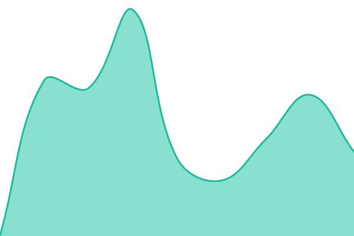
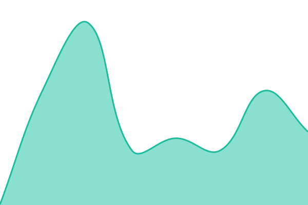
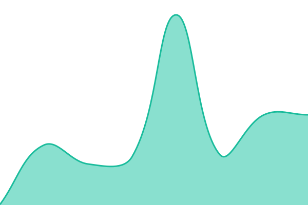
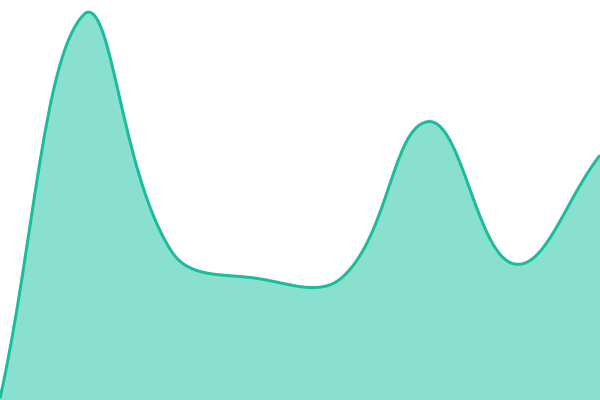
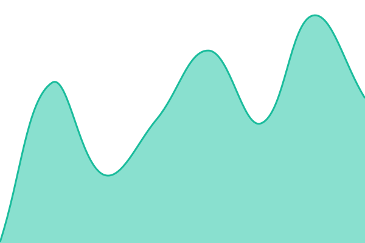
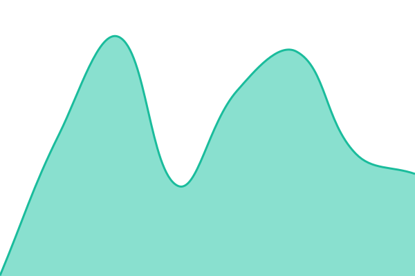
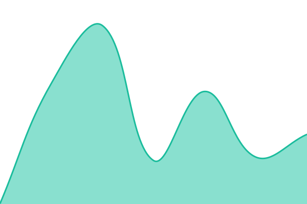
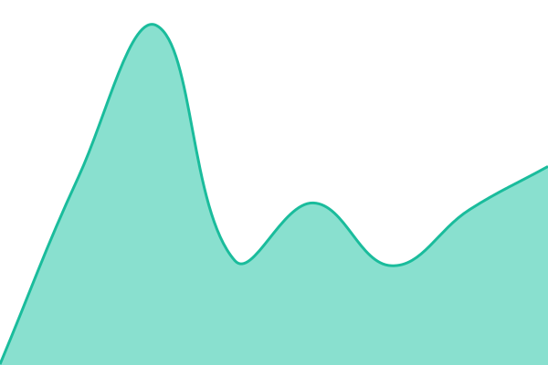

# [📈 Live Status](https://status.cyphera.my.id): <!--live status--> **🟩 All systems operational**

This repository contains the open-source uptime monitor and status page for [Fdzak01](cyphera.my.id), powered by [Upptime](https://github.com/upptime/upptime).

With [Upptime](https://upptime.js.org), you can get your own unlimited and free uptime monitor and status page, powered entirely by a GitHub repository. We use [Issues](https://github.com/FirmansyahDzakwanArifien/upptime/issues) as incident reports, [Actions](https://github.com/FirmansyahDzakwanArifien/upptime/actions) as uptime monitors, and [Pages](https://status.cyphera.my.id) for the status page.

<!--start: status pages-->
<!-- This summary is generated by Upptime (https://github.com/upptime/upptime) -->
<!-- Do not edit this manually, your changes will be overwritten -->
<!-- prettier-ignore -->
| URL | Status | History | Response Time | Uptime |
| --- | ------ | ------- | ------------- | ------ |
|  [Cyphera](https://cyphera.my.id) | 🟩 Up | [cyphera.yml](https://github.com/FirmansyahDzakwanArifien/upptime/commits/HEAD/history/cyphera.yml) | 

 321ms
     
 | 

<a href="https://status.cyphera.my.id/history/cyphera">100.00%</a>
    

|  [Portfolio CV](https://cyphera.my.id/cv/) | 🟩 Up | [portfolio-cv.yml](https://github.com/FirmansyahDzakwanArifien/upptime/commits/HEAD/history/portfolio-cv.yml) | 

 152ms
     
 | 

<a href="https://status.cyphera.my.id/history/portfolio-cv">100.00%</a>
    

|  [Portfolio Projects](https://cyphera.my.id/projects/) | 🟩 Up | [portfolio-projects.yml](https://github.com/FirmansyahDzakwanArifien/upptime/commits/HEAD/history/portfolio-projects.yml) | 

 173ms
     
 | 

<a href="https://status.cyphera.my.id/history/portfolio-projects">100.00%</a>
    

|  [Portfolio Labs](https://cyphera.my.id/labs/) | 🟩 Up | [portfolio-labs.yml](https://github.com/FirmansyahDzakwanArifien/upptime/commits/HEAD/history/portfolio-labs.yml) | 

 202ms
     
 | 

<a href="https://status.cyphera.my.id/history/portfolio-labs">100.00%</a>
    

|  [Portfolio Album](https://cyphera.my.id/album/) | 🟩 Up | [portfolio-album.yml](https://github.com/FirmansyahDzakwanArifien/upptime/commits/HEAD/history/portfolio-album.yml) | 

 153ms
     
 | 

<a href="https://status.cyphera.my.id/history/portfolio-album">100.00%</a>
    

|  [Portfolio Milestone](https://cyphera.my.id/milestone/) | 🟩 Up | [portfolio-milestone.yml](https://github.com/FirmansyahDzakwanArifien/upptime/commits/HEAD/history/portfolio-milestone.yml) | 

 185ms
     
 | 

<a href="https://status.cyphera.my.id/history/portfolio-milestone">100.00%</a>
    

|  [RSS Feed](https://cyphera.my.id/feed.xml) | 🟩 Up | [rss-feed.yml](https://github.com/FirmansyahDzakwanArifien/upptime/commits/HEAD/history/rss-feed.yml) | 

 122ms
     
 | 

<a href="https://status.cyphera.my.id/history/rss-feed">100.00%</a>
    

|  [security.txt](https://cyphera.my.id/.well-known/security.txt) | 🟩 Up | [security-txt.yml](https://github.com/FirmansyahDzakwanArifien/upptime/commits/HEAD/history/security-txt.yml) | 

 152ms
     
 | 

<a href="https://status.cyphera.my.id/history/security-txt">100.00%</a>
    

|  [Blog (Hashnode)](https://blog.cyphera.my.id) | 🟩 Up | [blog-hashnode.yml](https://github.com/FirmansyahDzakwanArifien/upptime/commits/HEAD/history/blog-hashnode.yml) | 

 581ms
     
 | 

<a href="https://status.cyphera.my.id/history/blog-hashnode">95.95%</a>
    

|  [Memoir](https://memoir.cyphera.my.id) | 🟩 Up | [memoir.yml](https://github.com/FirmansyahDzakwanArifien/upptime/commits/HEAD/history/memoir.yml) | 

 251ms
     
 | 

<a href="https://status.cyphera.my.id/history/memoir">100.00%</a>
    

|  [Si Ngacir (itch.io)](https://cyphera-game.itch.io/si-ngacir) | 🟩 Up | [si-ngacir-itch-io.yml](https://github.com/FirmansyahDzakwanArifien/upptime/commits/HEAD/history/si-ngacir-itch-io.yml) | 

 1463ms
     
 | 

<a href="https://status.cyphera.my.id/history/si-ngacir-itch-io">96.56%</a>
    

|  [Si Ngacir Wiki](https://wiki-si-ngacir.cyphera.my.id/en/) | 🟩 Up | [si-ngacir-wiki.yml](https://github.com/FirmansyahDzakwanArifien/upptime/commits/HEAD/history/si-ngacir-wiki.yml) | 

 290ms
     
 | 

<a href="https://status.cyphera.my.id/history/si-ngacir-wiki">100.00%</a>
    

|  [Varmintz](https://varmintz.cyphera.my.id) | 🟩 Up | [varmintz.yml](https://github.com/FirmansyahDzakwanArifien/upptime/commits/HEAD/history/varmintz.yml) | 

 243ms
     
 | 

<a href="https://status.cyphera.my.id/history/varmintz">100.00%</a>
    

|  [Excalidraw](https://excalidraw.cyphera.my.id) | 🟩 Up | [excalidraw.yml](https://github.com/FirmansyahDzakwanArifien/upptime/commits/HEAD/history/excalidraw.yml) | 

 278ms
     
 | 

<a href="https://status.cyphera.my.id/history/excalidraw">100.00%</a>
    

|  [IT-Tools](https://tools.cyphera.my.id) | 🟩 Up | [it-tools.yml](https://github.com/FirmansyahDzakwanArifien/upptime/commits/HEAD/history/it-tools.yml) | 

 237ms
     
 | 

<a href="https://status.cyphera.my.id/history/it-tools">100.00%</a>
    

|  [Barcode Generator](https://barcode.cyphera.my.id) | 🟩 Up | [barcode-generator.yml](https://github.com/FirmansyahDzakwanArifien/upptime/commits/HEAD/history/barcode-generator.yml) | 

 240ms
     
 | 

<a href="https://status.cyphera.my.id/history/barcode-generator">100.00%</a>
    

|  [SonarQube](https://sonarqube.cyphera.my.id) | 🟩 Up | [sonar-qube.yml](https://github.com/FirmansyahDzakwanArifien/upptime/commits/HEAD/history/sonar-qube.yml) | 

 857ms
     
 | 

<a href="https://status.cyphera.my.id/history/sonar-qube">100.00%</a>
    

|  [TLDR](https://tldr.cyphera.my.id) | 🟩 Up | [tldr.yml](https://github.com/FirmansyahDzakwanArifien/upptime/commits/HEAD/history/tldr.yml) | 

 277ms
     
 | 

<a href="https://status.cyphera.my.id/history/tldr">100.00%</a>
    

|  [Status Page](https://status.cyphera.my.id) | 🟩 Up | [status-page.yml](https://github.com/FirmansyahDzakwanArifien/upptime/commits/HEAD/history/status-page.yml) | 

 245ms
     
 | 

<a href="https://status.cyphera.my.id/history/status-page">100.00%</a>
    

<!--end: status pages-->

[**Visit our status website →**](https://status.cyphera.my.id)

## 📄 License

- Powered by: [Upptime](https://github.com/upptime/upptime)
- Code: [MIT](./LICENSE) © [Anand Chowdhary](https://anandchowdhary.com)
- Data in the `./history` directory: [Open Database License](https://opendatacommons.org/licenses/odbl/1-0/)
